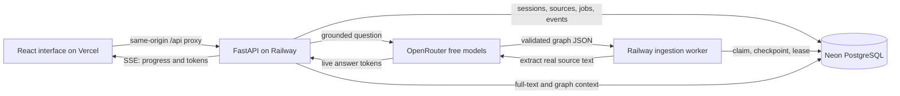

# KnowSphere AI

A document workspace for ML-ranked source search, cited AI answers, and knowledge graph exploration. PostgreSQL stores your records, a durable worker processes uploads, and live events keep the interface current. New accounts and spaces start empty. There are no seed records, mock services, fabricated counters, or fabricated fallback answers.

**Live application:** <https://knowsphere-ai-praneethpw.vercel.app>. The API and worker run on Railway with Neon and OpenRouter. See [DEPLOYMENT.md](DEPLOYMENT.md) for live resources, automatic Git deployments and hosted verification.

## Project layout

```text
KnowSphere-AI/
├── frontend/                 React + TypeScript application
│   ├── src/                  UI, Three.js graph, live events, streamed chat
│   ├── scripts/              Vercel proxy configuration and deployment preflight
│   ├── README.md             Frontend setup, design, build and Vercel deployment
│   └── AGENTS.md             Frontend contribution instructions
├── backend/                  FastAPI API and independent Python worker
│   ├── knowsphere/           Authentication, ingestion, graph analysis, retrieval, AI
│   ├── migrations/           Versioned PostgreSQL schema
│   ├── tests/                Unit and PostgreSQL integration tests
│   ├── Dockerfile            Non-root production container
│   └── README.md             Backend setup, API, deployment and operational notes
├── .railway/                 Current Railway Infrastructure as Code
├── .github/workflows/ci.yml
├── AGENTS.md
└── VERIFICATION.md
```

The two application source folders are `frontend` and `backend` (the spelling is intentional).

## What is implemented

- Account registration and sign-in, Argon2id password hashes, expiring HttpOnly sessions, sign-out and revocation of all sessions.
- Separate private knowledge spaces with server-side ownership checks on every resource.
- PDF, TXT, Markdown, and CSV upload; direct text ingestion; content deduplication and explicit document quotas.
- Durable PostgreSQL job claiming, progress events, chunk checkpoints, expiring leases, fencing against stale workers, bounded automatic retries, cancellation and manual retry.
- OpenRouter free-model entity and relationship extraction with structured validation. Quotes must occur in their source chunk; unsupported model evidence is discarded. Each passage requests up to 16 entities and 20 relationships to bound free-model output; extraction is selective, not exhaustive.
- Canonical entity resolution within a space, source-level relationship provenance, and deletion cascades that preserve entities still supported by other documents.
- Interactive Three.js graph with orbit/zoom, labels, entity search, type/confidence filters, camera reset, fullscreen, a keyboard-accessible entity list, and source inspection.
- Local checksum-verified MiniLM neural passage ranking on CPU, with exact source offsets and overlapping windows for long chunks. See [model setup and evaluation](backend/evaluation/README.md).
- Graph-assisted full-text retrieval with ranked-term broadening for natural questions; true provider token streaming; cited answers; conversation persistence and deletion. One bounded AI revision can repair missing/invalid source references. An unfinished or uncited answer is never saved as a completed answer.
- PageRank influence scores, Louvain community detection, and connected components computed from actual graph records.
- Replayable server-sent events for live ingestion/graph updates, reconnects, expired-session handling, and periodic snapshot recovery.
- Full graph JSON export, live worker health, configuration status, responsive layouts, loading/error/empty states, and reduced-motion support.

## Using the application

**Landing page → sign in or create an account → dashboard.**

- **Dashboard** (`/app`): add a source, enter an AI question, search source passages with ML, and see current source counts and AI/ML service status. Recent sources and processing counts update from actual live events.
- **Sources** (`/app/library`): upload or paste documents; inspect original text; follow processing progress; retry, cancel, or remove a source.
- **AI chat** (`/app/chat`): streamed answers with source citations, saved conversation history, and a compact progress indicator. Questions entered on the dashboard continue here.
- **Knowledge graph** (`/app/graph`): a keyboard-accessible entity list by default, with optional 3D exploration. Inspect supporting quotes, filter relationships, isolate neighborhoods, or trace paths. **Analysis** opens centrality scores and communities.
- **Activity** (`/app/operations`): live worker checkpoints, event history, failures, and retries. Detailed operational information stays here rather than appearing on every screen.
- **Search sources**: use the header button, the dashboard search action, or Cmd/Ctrl+K. MiniLM ranks candidate passages and every result opens its original source. Results refresh when the graph publishes or sources are removed.
- **Settings**: model readiness, AI configuration, worker health, account details, workspace rename, and graph export.

The interface uses a restrained dark palette and shared controls across landing, authentication, and workspace pages. Decorative backgrounds, the landing reactor, radar, appearance switches, global telemetry, and repeated idle panels have been removed. Three.js loads only when the user chooses the 3D graph; it renders on demand without ambient rotation. Live updates require no manual page refresh, but AI processing remains subject to provider availability and quotas.

## Stack and architecture

| Layer | Implementation |
| --- | --- |
| Frontend | React 19, TypeScript, Vite, Tailwind CSS 4, Framer Motion, React Three Fiber / Three.js, TanStack Query |
| API | Python 3.12, FastAPI, Pydantic, psycopg async connection pool |
| Database | Neon PostgreSQL; all tables are isolated in the `knowsphere` schema |
| AI | OpenRouter Chat Completions; Configurable Dots 3 Note free models for answers/extraction, free-only failover and explicit reasoning controls; paid IDs rejected |
| Retrieval | Indexed PostgreSQL full-text search, entity matches, one-hop graph evidence expansion and local MiniLM neural reranking |
| Local ML | Pinned INT8 MS MARCO MiniLM cross-encoder via ONNX Runtime CPU; no GPU or private-document training |
| Graph analytics | NetworkX PageRank, Louvain and connected components |
| Backend hosting | Railway: one API service and one continuously running worker |
| Frontend hosting | Vercel: static Vite build with same-origin API rewrites to Railway |



The local ML model ranks candidate source passages before search results and answer context are returned. OpenRouter performs extraction and answer generation. This does not add vector search, OCR, or training on private documents.

## Install and run locally

Follow [INSTALL.md](INSTALL.md) for fresh-clone installation, Docker or native PostgreSQL, every environment variable, API/worker/frontend commands, and deployment checks.

Templates are tracked at [`.env.example`](.env.example), [`backend/.env.example`](backend/.env.example), and [`frontend/.env.example`](frontend/.env.example). No private environment files are included. Copy each template into its own directory as `.env`; never commit actual credentials.

## Verification

```bash
cd frontend
npm test
npm run build
npm audit --audit-level=moderate
```

Backend tests use a **disposable local PostgreSQL database named with an `_test` suffix**. They intentionally refuse remote databases, including Neon, because the test schema is reset. Do not use your production connection string.

```bash
cd backend
source .venv/bin/activate
# First create a disposable local knowsphere_test database.
export TEST_DATABASE_URL='postgresql://your_local_role@127.0.0.1:5432/knowsphere_test'
python -m pytest -q
ruff check knowsphere tests
ruff format --check knowsphere tests
```

Without `TEST_DATABASE_URL`, unit tests run and database integration tests are explicitly skipped. Provider requests are not mocked by the application. Live provider verification is described separately in `VERIFICATION.md`.

## Production deployment

Read both folder READMEs. Deploy **two Railway services**, using `backend` as their root directory: `knowsphere-api` and `knowsphere-worker`. Current configuration is recorded in `.railway/railway.ts`; see `.railway/README.md`. Railway no longer accepts `railway.json` for new services. Set backend secrets on both services, and enable TLS cookies and the exact Vercel frontend origin. Run migrations as a pre-deploy command.

Deploy the frontend from the `frontend` root directory on Vercel. Before submitting that deployment, generate and commit the same-origin proxy using the actual Railway API origin:

```bash
cd frontend
RAILWAY_API_URL='https://YOUR-ACTUAL-RAILWAY-API-ORIGIN' npm run configure:vercel
```

The explicit placeholder above is setup documentation, never a runtime fallback. Vercel's build preflight rejects an unconfigured API rewrite. Do not put Neon or OpenRouter secrets in Vercel frontend environment variables. Do not cache `/api` responses.

## Operational limits and honest guarantees

- OpenRouter free models have provider-controlled daily/minute quotas and availability. They cannot supply an unlimited production SLA. Each unprocessed ~6,000-character chunk requires one inference request, and each answer requires another. Rate-limit retries also consume quota. The default document limit can therefore consume a substantial part of a free daily allowance.
- Up to 10 MB and 120,000 extracted characters per source; up to 200 PDF pages, 200 documents per space and 10 spaces per account by default. HTTP proxies may impose smaller upload limits; verify the hosted path before advertising its maximum.
- The interactive graph and analytics are bounded to 600 entities and 4,000 relationships. Export returns all ready graph records. Entity detail panels show at most 100 sources and 100 relationships.
- Live events use a durable PostgreSQL event log with a two-second poll interval. Streams reconnect every 50 seconds to avoid proxy connection limits; a one-minute snapshot refresh repairs missed history. This is near-real-time, not a sub-millisecond guarantee.
- Candidates come from lexical and graph expansion, then local MiniLM ranks their relevance. Synonyms without lexical/entity overlap may still miss the candidate pool; the API returns an explicit no-source result rather than inventing an answer.
- A citation is provenance, not independent truth verification. Quote validation does not prove a relationship is correct. Review the original passage.
- Saved conversations retain their answer and citation snapshots when an original document is deleted. Delete the conversation separately to remove those saved excerpts.
- This release is for private individual workspaces. Team sharing, OAuth, email verification, password-reset email delivery, OCR, website crawling, billing and backups managed by the application are not implemented. There are no inactive buttons pretending to provide them.
- Production operations still require verified cloud deployments, suitable Neon backup/PITR retention, uptime alerts, log retention, an external edge abuse limit, and load testing for your expected traffic. The included tests are functional checks, not a capacity or penetration-test certification.

## Reference documentation

- [OpenRouter free models and limits](https://openrouter.ai/collections/free-models)
- [OpenRouter API documentation](https://openrouter.ai/docs/quickstart)
- [Neon connection setup](https://neon.com/docs/connect/connect-from-any-app)
- [Vercel external rewrites](https://vercel.com/docs/routing/rewrites)
- [Railway configuration as code](https://docs.railway.com/guides/config-as-code)

## Local ML relevance model

Install backend requirements, then run `python -m knowsphere.prepare_ml` from `backend` before starting the API. The Docker build performs this automatically. `ML_ENABLED=true`, `ML_CANDIDATES=32` and `ML_THREADS=2` are documented in `backend/.env.example`. Settings reports the loaded model; search results identify neural ranking. The model ranks original passages and preserves source evidence; it does not make generated answers infallible. See [reproducible public evaluation](backend/evaluation/README.md).

On the complete **BEIR SciFact test split (300 queries, 5,183 abstracts)**, relevant-source Hit@1 increased from **23.00% to 51.67%** and Recall@8 from **47.89% to 62.64%** compared with the previous PostgreSQL pipeline. These measure retrieval relevance, not answer factuality or guaranteed performance on private documents. [Methodology, limitations and raw results](backend/evaluation/README.md#measured-results--27-november-2026).
