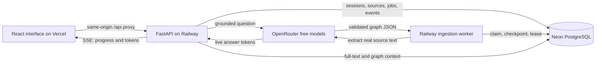

# KnowSphere AI

An intelligent knowledge graph generation and discovery platform, built with real PostgreSQL persistence, OpenRouter inference, a durable ingestion worker, a 3D graph explorer, and source-grounded research conversations. New accounts and spaces start empty. There are no seed records, mock services, fabricated counters, or AI fallback answers.

## Project layout

```text
KnowSphere-AI/
├── frontend/                 React + TypeScript application
│   ├── src/                  UI, Three.js graph, live events, streamed chat
│   ├── scripts/              Vercel proxy configuration and deployment preflight
│   ├── README.md             Frontend setup, design, build and Vercel deployment
│   └── AGENTS.md             Frontend contribution instructions
├── backend/                  FastAPI API and independent Python worker
│   ├── knowsphere/           Authentication, ingestion, graph analysis, retrieval, AI
│   ├── migrations/           Versioned PostgreSQL schema
│   ├── tests/                Unit and PostgreSQL integration tests
│   ├── Dockerfile            Non-root production container
│   ├── railway*.json         API and worker deployment configuration
│   └── README.md             Backend setup, API, deployment and operational notes
├── .github/workflows/ci.yml
├── AGENTS.md
└── VERIFICATION.md
```

The two application source folders are `frontend` and `backend` (the spelling is intentional).

## What is implemented

- Account registration and sign-in, Argon2id password hashes, expiring HttpOnly sessions, sign-out and revocation of all sessions.
- Separate private knowledge spaces with server-side ownership checks on every resource.
- PDF, TXT, Markdown, and CSV upload; direct text ingestion; content deduplication and explicit document quotas.
- Durable PostgreSQL job claiming, progress events, chunk checkpoints, expiring leases, fencing against stale workers, bounded automatic retries, cancellation and manual retry.
- OpenRouter free-model entity and relationship extraction with structured validation. Quotes must occur in their source chunk; unsupported model evidence is discarded.
- Canonical entity resolution within a space, source-level relationship provenance, and deletion cascades that preserve entities still supported by other documents.
- Interactive Three.js graph with orbit/zoom, labels, entity search, type/confidence filters, camera reset, fullscreen, a keyboard-accessible entity list, and source inspection.
- Graph-assisted full-text retrieval; true provider token streaming; cited answers; conversation persistence and deletion. An unfinished or uncited answer is never saved as a completed answer.
- PageRank influence scores, Louvain community detection, and connected components computed from actual graph records.
- Replayable server-sent events for live ingestion/graph updates, reconnects, expired-session handling, and periodic snapshot recovery.
- Full graph JSON export, live worker health, configuration status, responsive layouts, loading/error/empty states, and reduced-motion support.

## Stack and architecture

| Layer | Implementation |
| --- | --- |
| Frontend | React 19, TypeScript, Vite, Tailwind CSS 4, Framer Motion, React Three Fiber / Three.js, TanStack Query |
| API | Python 3.12, FastAPI, Pydantic, psycopg async connection pool |
| Database | Neon PostgreSQL; all tables are isolated in the `knowsphere` schema |
| AI | OpenRouter Chat Completions; `openrouter/free` by default; paid model IDs rejected |
| Retrieval | Indexed PostgreSQL full-text search, entity matches and one-hop graph evidence expansion |
| Graph analytics | NetworkX PageRank, Louvain and connected components |
| Backend hosting | Railway: one API service and one continuously running worker |
| Frontend hosting | Vercel: static Vite build with same-origin API rewrites to Railway |



No paper was supplied. This is an independently implemented graph-assisted retrieval architecture, not a claimed reproduction of a specific research paper. No model training, vector embeddings, semantic similarity engine, or OCR is asserted. Graph algorithms supply useful discovery without an extra model service. The decorative landing-page sphere is procedural artwork, not a preview of stored knowledge.

## Project location and Git

The local project is at `/Users/praneethreddy/Freelance Projects /KnowSphere-AI`. The existing parent folder has a trailing space in its name; preserve it when using an absolute shell path. From your current `Freelance Projects` terminal, simply run `cd KnowSphere-AI`.

Git has been initialized on `main`. The private `backend/.env`, virtual environment, Node dependencies and build output are ignored. Create an empty private GitHub repository, then use its actual URL:

```bash
git add .
git commit -m "Build KnowSphere AI"
# Add your actual newly created repository URL:
git remote add origin YOUR_GITHUB_REPOSITORY_URL
git push -u origin main
```

If Git requests an author identity, configure your own name and email locally before committing. Connect this repository to Railway and Vercel using the folder-specific settings below.

## Local installation

Requirements: Node.js 22.12+ (24 recommended), Python 3.12, and a Neon PostgreSQL connection. Use a separate Neon branch for development if this database also serves production.

### 1. Configure and migrate the backend

```bash
cd backend
python3.12 -m venv .venv
source .venv/bin/activate
python -m pip install --require-hashes -r requirements-dev.lock
cp -n .env.example .env
chmod 600 .env
```

Edit `backend/.env` privately. Set `DATABASE_URL` to your Neon connection string (keep `sslmode=require` or stronger) and `OPENROUTER_API_KEY` to your OpenRouter key. Keep these secrets out of the frontend. The supplied local checkout has already been configured from the credentials supplied during development; downloadable source archives exclude that file.

```bash
python -m knowsphere.migrate
python -m uvicorn knowsphere.main:app --host 127.0.0.1 --port 8000
```

### 2. Start the ingestion worker in a second terminal

```bash
cd backend
source .venv/bin/activate
python -m knowsphere.worker
```

The worker is required for ingestion. The API deliberately does not launch an unreliable in-process background queue.

### 3. Start the frontend in a third terminal

```bash
cd frontend
npm ci
npm run dev
```

Open <http://localhost:5173>. Create your own account, add a source, wait for its real ingestion status to become **Ready**, explore the graph, then ask a question about a named topic in that source. The frontend development proxy forwards `/api` to `http://127.0.0.1:8000`.

## Verification

```bash
cd frontend
npm test
npm run build
npm audit --audit-level=moderate
```

Backend tests use a **disposable local PostgreSQL database named with an `_test` suffix**. They intentionally refuse remote databases, including Neon, because the test schema is reset. Do not use your production connection string.

```bash
cd backend
source .venv/bin/activate
# First create a disposable local knowsphere_test database.
export TEST_DATABASE_URL='postgresql://your_local_role@127.0.0.1:5432/knowsphere_test'
python -m pytest -q
ruff check knowsphere tests
ruff format --check knowsphere tests
```

Without `TEST_DATABASE_URL`, unit tests run and database integration tests are explicitly skipped. Provider requests are not mocked by the application. Live provider verification is described separately in `VERIFICATION.md`.

## Production deployment

Read both folder READMEs. Deploy **two Railway services**, using `backend` as their root directory: the API with `railway.json`, and the worker with `railway.worker.json`. Set backend secrets on both services, and enable TLS cookies and the exact Vercel frontend origin. Run migrations as a pre-deploy command.

Deploy the frontend from the `frontend` root directory on Vercel. Before submitting that deployment, generate and commit the same-origin proxy using the actual Railway API origin:

```bash
cd frontend
RAILWAY_API_URL='https://YOUR-ACTUAL-RAILWAY-API-ORIGIN' npm run configure:vercel
```

The explicit placeholder above is setup documentation, never a runtime fallback. Vercel's build preflight rejects an unconfigured API rewrite. Do not put Neon or OpenRouter secrets in Vercel frontend environment variables. Do not cache `/api` responses.

## Operational limits and honest guarantees

- OpenRouter free models have provider-controlled daily/minute quotas and availability. They cannot supply an unlimited production SLA. Each unprocessed ~6,000-character chunk requires one inference request, and each answer requires another. Rate-limit retries also consume quota. The default document limit can therefore consume a substantial part of a free daily allowance.
- Up to 10 MB and 120,000 extracted characters per source; up to 200 PDF pages, 200 documents per space and 10 spaces per account by default. HTTP proxies may impose smaller upload limits; verify the hosted path before advertising its maximum.
- The interactive graph and analytics are bounded to 600 entities and 4,000 relationships. Export returns all ready graph records. Entity detail panels show at most 100 sources and 100 relationships.
- Live events use a durable PostgreSQL event log with a two-second poll interval. Streams reconnect every 50 seconds to avoid proxy connection limits; a one-minute snapshot refresh repairs missed history. This is near-real-time, not a sub-millisecond guarantee.
- Retrieval is lexical plus graph expansion. Synonyms without lexical/entity overlap may not retrieve the right passage; the API returns an explicit no-source result rather than inventing an answer.
- A citation is provenance, not independent truth verification. Quote validation does not prove a relationship is correct. Review the original passage.
- Saved conversations retain their answer and citation snapshots when an original document is deleted. Delete the conversation separately to remove those saved excerpts.
- This release is for private individual workspaces. Team sharing, OAuth, email verification, password-reset email delivery, OCR, website crawling, billing and backups managed by the application are not implemented. There are no inactive buttons pretending to provide them.
- Production operations still require verified cloud deployments, suitable Neon backup/PITR retention, uptime alerts, log retention, an external edge abuse limit, and load testing for your expected traffic. The included tests are functional checks, not a capacity or penetration-test certification.

## Reference documentation

- [OpenRouter free models and limits](https://openrouter.ai/collections/free-models)
- [OpenRouter API documentation](https://openrouter.ai/docs/quickstart)
- [Neon connection setup](https://neon.com/docs/connect/connect-from-any-app)
- [Vercel external rewrites](https://vercel.com/docs/routing/rewrites)
- [Railway configuration as code](https://docs.railway.com/guides/config-as-code)
